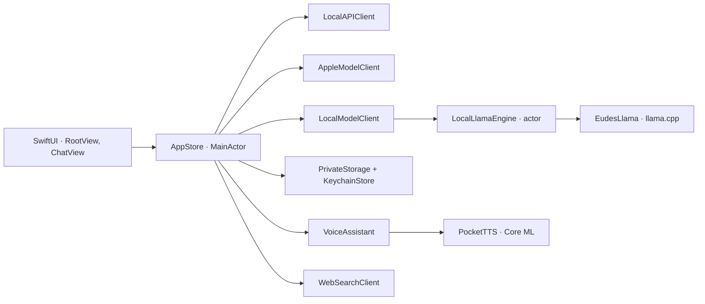

# Architecture

Carte du code pour s'orienter vite. Les règles de travail sont dans [AGENTS.md](../AGENTS.md), les parcours de livraison dans [DELIVERY_WORKFLOWS.md](DELIVERY_WORKFLOWS.md).

## Vue d'ensemble

Une app SwiftUI, un état applicatif central, trois moteurs interchangeables derrière le même contrat.

| Rôle | Protocole | Implémentations |
|---|---|---|
| Générer une réponse | `EudesAPIClient` | `LocalAPIClient` (serveur), `AppleModelClient`, `LocalModelClient` (GGUF) |
| Reprendre une réponse interrompue | `RecoverableResponseClient` | `OpenAIRecoverableResponseClient` |
| Chercher sur le Web | `WebSearching` | `WebSearchClient` |
| Transcrire la voix | `LocalSpeechTranscribing` | transcription Apple (`SpeechAnalyzer`) |

## État applicatif

`AppStore` (`ios/Eudes/App/AppStore.swift`, `@MainActor ObservableObject`) porte tout : profils de serveurs, conversations, brouillons et images jointes, état de génération, vérification de connexion, réglages de contexte. Les vues lisent ses propriétés publiées ; les services ne connaissent pas SwiftUI. Les dépendances coûteuses sont injectées à l'initialisation (client HTTP, recherche Web, moteur local, horloge), ce qui rend la suite XCTest déterministe.

## Concurrence

- L'interface et l'état vivent sur le `MainActor` ; les appels longs sont des `Task` annulables.
- Le moteur local est un `actor` (`LocalLlamaEngine`) : un seul chargement à la fois, génération sérialisée, déchargement explicite.
- La progression de génération est diffusée par un callback `@MainActor`, jamais en écrivant l'état depuis un fil de fond.
- La reprise après retour au premier plan repose sur un drapeau **gardé en mémoire** : une app relancée depuis zéro ne reprend pas une génération interrompue.

## Persistance

| Donnée | Emplacement | Protection |
|---|---|---|
| Conversations, profils, réglages | `Application Support/EudesPrivate/workspace.json` | protection de fichiers complète, dossier et fichier exclus des sauvegardes |
| Clés d'API | trousseau | `synchronizable=false`, `WhenUnlockedThisDeviceOnly` |
| Modèles GGUF | dossier applicatif, hors sauvegarde | vérification SHA-256 à l'installation, cache d'empreintes en mémoire |

`PrivateStorage` centralise les chemins et les écritures ; `KeychainStore` les clés. Aucun journal de prompts n'est écrit sur disque.

## Réseau

`LocalAPIClient` crée une session éphémère par opération : pas de cache disque, pas de cookies partagés, pas de proxy applicatif. `NoRedirectDelegate` refuse toute redirection. HTTP n'est accepté que vers les plages privées et la boucle locale, avec un consentement par profil ; HTTPS garde la validation système. Le flux SSE est décodé par `SSEDecoder`, avec bornes de taille et remontée des erreurs de flux.

## Moteurs

- **Serveur** : Chat Completions par défaut, Responses en option, avec reprise des réponses interrompues quand le serveur l'expose.
- **Apple** : `LanguageModelSession` sur iOS 26+, outils `web_search` et `web_fetch` déclarés en `@Generable`, résultats réinjectés dans une synthèse séparée.
- **Local** : llama.cpp compilé via `EudesLlama`. `LocalChatTemplate` applique le gabarit du modèle, `LocalReasoningBoundary` sépare le raisonnement du texte affiché. GPU (`n_gpu_layers = 99`) au premier plan, CPU lorsque l'app n'est pas active, CPU sur simulateur.
- **Catalogue** : `LocalModelCatalog` décrit fichiers, tailles, empreintes SHA-256 et licences ; `LocalModelFileStore` télécharge et vérifie ; `LocalModelDownloads` suit la progression et l'annulation.

## Voix

Transcription Apple locale, génération par le moteur sélectionné, lecture par les voix système ou PocketTTS en Core ML. `BackgroundVoiceSession` maintient la session hors premier plan avec `VoiceActivityController` et une Live Activity du widget ; `SiriAssistant` et `VoiceActions` exposent les App Intents « Poser une question à Eudes » et « Ouvrir l'assistant vocal Eudes ». Détails : [SIRI.md](SIRI.md), [VOICE_ACTIONS.md](VOICE_ACTIONS.md), [POCKETTTS_COREML.md](POCKETTTS_COREML.md).

## Recherche Web

`WebSearchClient` collecte des sources, `WebSearchContext` les résume sous un budget d'octets pour les tours suivants : le texte intégral ne sert qu'au tour courant. Pour le modèle Apple, la recherche passe par les outils natifs. Détails : [WEB_SEARCH.md](WEB_SEARCH.md), [APPLE_TOOLS.md](APPLE_TOOLS.md).

## Tests

`ios/EudesTests` couvre l'endpoint et les URL, le SSE, le stockage privé, le trousseau, la voix et l'audio d'arrière-plan, PocketTTS, Siri et les parcours Apple. Les services sont remplacés par des fixtures via les protocoles, jamais par des appels réseau réels. Les scripts Python de `tools/` ont leurs propres tests dans `tests/`, exécutés par `automation-checks.yml`.

## Scripts de livraison

| Script | Rôle |
|---|---|
| `tools/test-ios.sh` | suite XCTest sur simulateur |
| `tools/build-device.sh` | compilation Release pour un appareil connecté |
| `tools/install-iphone.py` | installation sur l'appareil détecté |
| `tools/package_ipa.py` | vérification des numéros et IPA non signée |
| `tools/delivery_version.py` | réservation des numéros de version |
| `tools/delivery_control.py` | contrôle des preuves avant validation finale |
| `tools/update-project-workflow.py` | transitions du projet GitHub |

## Où lire quoi

- Comportement produit et installation : [README](../README.md)
- Parcours de livraison : [DELIVERY_WORKFLOWS.md](DELIVERY_WORKFLOWS.md)
- Numéros de version : [IPA_VERSIONING.md](IPA_VERSIONING.md)
- Protocoles serveur : [PROTOCOLS.md](PROTOCOLS.md)
- Contexte et génération : [CONTEXT.md](CONTEXT.md)
- Rendu du texte : [RICH_MARKDOWN.md](RICH_MARKDOWN.md), orthographe : [SPELLCHECK.md](SPELLCHECK.md)
